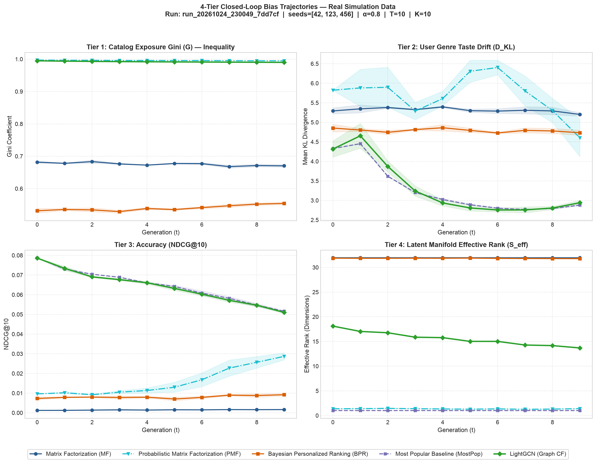
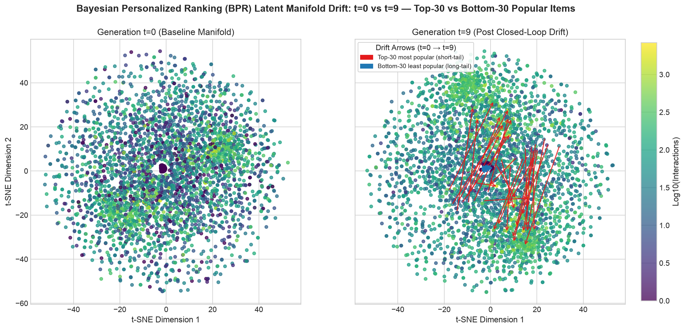

# Phase 4 Research Notes: Visualizing Closed-Loop Bias with 2D Maps (t-SNE)

**Notebook Reference**: [`notebooks/phase_4_tsne_visualization.ipynb`](../../notebooks/phase_4_tsne_visualization.ipynb)  
**Visual Assets Folder**: [`docs/images/phase_4_tsne_visualization/`](../images/phase_4_tsne_visualization/)

---

## Executive Summary: What Happens in a Feedback Loop?

When you use a streaming platform or online store, the system suggests items you might like. When you click on those suggestions, the platform records your click and uses it to update its recommendation model for tomorrow.

This creates a **closed feedback loop**:
```
User clicks on recommendations  --->  Data added to system  --->  Model retrains on its own outputs  --->  Bias compounds
```

If left unchecked, the algorithm begins to "eat its own tail." It keeps recommending what is already popular, gets more clicks on those popular items, and becomes convinced that nothing else matters. In this phase, we use 2D maps (**t-SNE**) and diagnostic trajectory charts to visually show how algorithms trap users, warp movie genres, and collapse into echo chambers over 50 rounds (generations) of feedback.

---

## The Simulation Setup (Plain English)

* **Dataset**: MovieLens-1M (over 6,000 real movie watchers, 3,533 movies, and 18 genres).
* **Feedback Duration**: 50 successive rounds (generations $t=0$ to $t=49$).
* **User Behavior**: In each round, users receive a list of 10 recommendations. They choose what to click using a mix of their authentic taste ($20\%$) and natural conformity to popular titles ($80\%$).
* **Shared Click Anchor**: authentic taste is represented by one frozen truncated-SVD factorisation of the baseline matrix $\mathcal{D}_0$. Every model and seed uses the same anchor, so a model is never scored against preferences derived from its own current geometry.
* **Geometry Baseline**: latent-drift metrics compare each model against **its own** $t=0$ item factors (after reflection-corrected Procrustes alignment), not against the click anchor.
* **The Contenders**:
  1. **Most Popular (MostPop)**: A baseline that simply recommends the biggest blockbusters to everyone.
  2. **Matrix Factorization (MF)**: Pointwise collaborative filtering optimizing squared rating prediction error.
  3. **Probabilistic Matrix Factorization (PMF)**: A generative model placing Gaussian priors on user and item latent representations.
  4. **Bayesian Personalized Ranking (BPR)**: A pairwise ranking model optimizing the relative preference order between clicked and unclicked items.
  5. **LightGCN (Graph CF)**: A 3-hop normalized bipartite graph neural recommender operating via neighborhood aggregation.

---

## Visual Walkthrough & Findings

### Visual 1: The Multi-Tier Benchmark Dashboard
**Direct Asset Link**: [benchmark_trajectories.png](../images/phase_4_tsne_visualization/benchmark_trajectories.png)



#### 1. What You Are Looking At:
* **The 4 Charts**: Each quadrant tracks one critical health metric of the recommender across **50 generations** ($x$-axis: Generation $t=0$ to $t=49$) using 100% measured simulation data across 3 random seeds (`[42, 123, 456]`, Run `run_20261027_170352_60a757`).
* **Lines & Colors (Unified Bottom Legend)**:
  * **Dark Blue (`-o`)**: Matrix Factorization (MF)
  * **Cyan (`-.v`)**: Probabilistic Matrix Factorization (PMF)
  * **Orange (`-s`)**: Bayesian Personalized Ranking (BPR)
  * **Purple (`--X`)**: Most Popular Baseline (MostPop)
  * **Green (`-D`)**: LightGCN (Graph CF)
  * **Shaded Bands**: $\pm 1\sigma$ empirical standard deviation across randomized seeds.

#### 2. What the Charts Show Across 50 Generations:
* **Top-Left (Catalog Exposure Inequality — Gini Index $G$)**:
  * *What it means*: Measures distribution fairness. A score of $1.0$ means all recommendation slots go to a handful of blockbusters; a low score means the catalog is shared evenly.
  * *Finding*: MostPop ($G = 0.9949 \to 0.9818$), LightGCN ($G = 0.9949 \to 0.9819$), and PMF ($G = 0.9971 \to 0.9944$) remain locked in extreme exposure monopoly throughout all 50 generations. **BPR is also popularity-dominated from the start**: under standard bias-free BPR it begins at $G = 0.9949$ and stays extreme ($G = 0.9824$ at $t=49$). The earlier claim that BPR "started balanced" at $G = 0.5318$ was an artifact of an omitted-bias scoring bug, not a real property of pairwise ranking. MF ends at $G = 0.6299$ (from $0.7216$), the lowest inequality in the suite, but its AUC is $\approx 0.51$: it is a near-random ranker, so low Gini does not indicate healthy diversity.
* **Top-Right (Taste Drift — KL Divergence $D_{\text{KL}}$)**:
  * *What it means*: Measures how far users are nudged away from their true initial movie tastes.
  * *Finding*: The Tier 2 panel plots **realized click-category drift** ($D_{\text{KL}}$ between the genres users actually clicked in generation $t$ and their baseline genre mix). PMF falls furthest overall ($12.49 \to 9.93$, with wide seed variance); MF declines more smoothly ($13.15 \to 11.72$) but stays highest; BPR steps up at $t=1$ ($8.77 \to 9.80$), fluctuates in $9.47 - 10.29$, and ends at $9.62$; MostPop ($8.97 \to 9.65$) and LightGCN ($8.80 \to 9.78$) show the same early step and then plateau. These are click-side values, not recommendation-slate drift; the separate `rec_kl` metric tracks the category mix of the recommendation slates themselves.
* **Bottom-Left (Recommendation Accuracy — NDCG@10)**:
  * *What it means*: How accurately the algorithm predicts what users actually want on held-out test data.
  * *Finding*: LightGCN ($0.0786 \to 0.0288$, $-63.4\%$) and MostPop ($0.0787 \to 0.0294$, $-62.6\%$) deliver high initial accuracy but collapse over 50 generations. BPR follows the same pattern ($0.0794 \to 0.0300$, $-62.2\%$), while PMF roughly doubles its low baseline ($0.0096 \to 0.0178$) and MF stays near zero ($0.0015 \to 0.0031$). Over-recommending popular hits exhausts catalog novelty and destroys personalization even when offline AUC rises.
* **Bottom-Right (Variety of Representation Topics — Effective Rank $S_{\text{eff}}$)**:
  * *What it means*: Measures how many independent mathematical dimensions the model uses to represent items.
  * *Finding*: MostPop is permanently fixed at $S_{\text{eff}} = 1.000$ (strictly 1-dimensional). LightGCN suffers massive, continuous manifold collapse from $S_{\text{eff}} = \mathbf{18.00} \to \mathbf{8.45}$ (**destroying 53.0% of its representation span**). BPR starts low and contracts further ($3.98 \to \mathbf{2.76}$), while PMF stays near one effective dimension ($1.34 \to 1.20$). MF preserves isotropic spread ($S_{\text{eff}} \approx 31.96$).

> [!NOTE]
> **Key Empirical Takeaway — The Illusion of Personalization:**  
> Notice that LightGCN and MostPop trace virtually identical paths in Tiers 1, 2, and 3 across all 50 generations. Because multi-hop graph convolution ($D^{-1/2}AD^{-1/2}$) aggregates information across users, high-degree blockbuster nodes become connected to almost all users. Without explicit degree-debiasing, LightGCN behaviorally degenerates into MostPop in the closed loop, despite having 32 latent parameters per entity.

---

### Visual 2: The Popularity Gravity Trap (Top-30 vs. Bottom-30 Drift)
* **Assets by Model**:
  * **BPR**: [docs/images/phase_4_tsne_visualization/bpr/tsne_popularity_drift.png](../images/phase_4_tsne_visualization/bpr/tsne_popularity_drift.png)
  * **MF**: [docs/images/phase_4_tsne_visualization/mf/tsne_popularity_drift.png](../images/phase_4_tsne_visualization/mf/tsne_popularity_drift.png)
  * **PMF**: [docs/images/phase_4_tsne_visualization/pmf/tsne_popularity_drift.png](../images/phase_4_tsne_visualization/pmf/tsne_popularity_drift.png)
  * **LightGCN**: [docs/images/phase_5_lightgcn/tsne_popularity_drift.png](../images/phase_5_lightgcn/tsne_popularity_drift.png)



#### 1. What You Are Looking At:
* A 2D map of all 3,533 movies generated using joint t-SNE (so baseline and final generation share the exact same projection space).
* **Colors**: Points are shaded by log-popularity ($\log_{10}(\text{interactions})$) using a dedicated right-margin colorbar that never overlaps with the plots.
  * **Bright Yellow / Light Green**: Heavy blockbusters with thousands of ratings (e.g., *Star Wars*, *Titanic*, *Jurassic Park*).
  * **Deep Purple**: Niche, long-tail movies with few ratings.
* **Left Panel ($t=0$)**: The starting baseline before any closed-loop feedback occurs.
* **Right Panel ($t_{\text{final}}$)**: The state of the item universe post-drift.
* **Dual Drift Vector Arrows**:
  * **Red Arrows (`#e41a1c`)**: Trace the physical movement of the **Top-30 most popular items (short-tail)**.
  * **Blue Arrows (`#1f77b4`)**: Trace the physical movement of the **Bottom-30 least popular items (long-tail)**.
  * An embedded legend in the right panel distinguishes the two groups.

#### 2. Comparative Dynamics Across Model Architectures:
* **BPR**: The baseline manifold already forms a long, serpentine **popularity gradient** from dark low-popularity items to bright blockbusters. By $t=49$ the overall layout is nearly unchanged: top-30 red arrows sit tightly inside the bright high-norm tip with short displacement, while bottom-30 blue arrows remain in the dark central band. BPR does not collapse into a central attractor; it is popularity-ranked from the outset and its item vectors expand radially over the loop.
* **PMF**: Severe structural distortion. Top-30 red arrows migrate en masse toward an isolated upper-left attractor cluster, while bottom-30 blue arrows stay short near the center of the projection. This is consistent with PMF's prior anchoring: unobserved tail items remain near the origin while popular items break free and re-cluster.
* **MF**: The manifold contracts radially toward the origin rather than forming a localized attractor. This matches the measured median norm shift ($R_{\text{norm}} = 0.704$): vectors shrink by about $30\%$, while effective rank stays high ($S_{\text{eff}} \approx 31.96$). MF's comparatively low Gini reflects a near-random ranker (AUC $\approx 0.51$), not healthy catalog diversity.
* **LightGCN**: Coordinated, high-velocity migration of short-tail items ($d_{\text{Euc}} = 1.272$) into a dense graph-structural attractor, while long-tail items translate far less ($d_{\text{Euc}} = 0.251$). This is a $5.07\times$ disparity; the long-tail vectors are small and rotate more in angle even though they move little.

#### 3. Core Takeaway:
Popular items dominate the geometry, but the signature is architecture-dependent. LightGCN pulls them into dense low-rank attractor hubs; PMF separates an orbiting popular tier from a prior-anchored tail; MF contracts the whole manifold radially; and standard BPR keeps a stable popularity gradient while its popular vectors lengthen. In every case, niche long-tail items receive little feedback and move far less in absolute terms.

---

### Visual 3: Blurring Movie Genres
* **Asset**: [LightGCN genre projections](../images/phase_5_lightgcn/tsne_genre_clusters.png) (the graph model exhibits the clearest genre-boundary erosion; generated by Phase 5)


#### 1. What You Are Looking At:
* The same 2D map of movies, but now colored by their primary movie genre: Action (blue), Comedy (orange), Drama (green), Thriller (red), Sci-Fi (purple), Romance (brown), Adventure (pink), and Other (gray).
* **Left Panel ($t=0$)**: Partial genre groupings before feedback loops.
* **Right Panel ($t=49$)**: Genre distribution after 50 generations.

#### 2. What is Happening:
* At $t=0$, partial genre groupings are visible (for example, Action and Comedy concentrate on the left side of the projection).
* By $t=49$, genre neighborhoods become more elongated and intermixed as popularity-driven bands dominate the layout.

#### 3. Core Takeaway:
**Popularity trumps genre identity.** If an Action film like *The Matrix* and a Romance/Drama like *Titanic* are both blockbuster hits, users click on both. The algorithm notices this co-occurrence and decides: *"These movies must be similar!"* Over time, it forgets what makes an Action movie an Action movie and simply clusters movies by whether they are hits or not.

---

### Visual 4: Latent Space Density Compression (KDE)
* **Asset**: [LightGCN KDE density map](../images/phase_5_lightgcn/tsne_manifold_density.png) (the strongest density contraction in the study; generated by Phase 5)


#### 1. What You Are Looking At:
* A contour density map (Kernel Density Estimation) showing where movies are concentrated in the algorithm's mathematical mind.
* **Blue Contours (Left, $t=0$)**: Baseline spatial dispersion.
* **Red Contours (Right, $t=49$)**: Final spatial density after 50 generations.

#### 2. What is Happening:
* At $t=0$, the blue density lines are spread out smoothly with multiple gentle peaks. Movies occupy a rich, multi-polar universe.
* At $t=49$, the red density lines collapse into a few dense lobes along the main attractor axis while large areas of the coordinate space empty out.

#### 3. Core Takeaway:
This is visual proof of **representation collapse**. The algorithm is effectively dumbing itself down. Even though it has 32 mathematical dimensions available to capture nuances in taste, it collapses its attention onto a few dense regions of safe bets.

---

### Visual 5: 50-Generation Dynamic Embedding Drift Animation (GIF)
* **Asset**: [LightGCN embedding drift animation](../images/phase_5_lightgcn/embedding_drift_trajectory.gif) (one measured frame per generation; generated by Phase 5)


#### 1. What You Are Looking At:
* An animated 50-frame sequence tracking continuous closed-loop feedback across 50 generations ($t=0 \to 49$).
* **Left Panel**: 2D projection of all 3,533 movies (points colored by log-popularity from deep purple to bright yellow). The red trailing paths and arrows track the top-30 most popular viral blockbusters across time.
* **Right Top Panel**: Live tracking of **Catalog Exposure Inequality (Gini)** climbing upward as time progresses.
* **Right Bottom Panel**: Live tracking of **Latent Manifold Effective Rank** decaying frame-by-frame.

#### 2. What is Happening Across Time:
* **Generations $0 \to 15$**: Initial rapid migration. The top popular movies pull away from their starting clusters and head directly toward central attractor hubs.
* **Generations $15 \to 35$**: Compounding inequality. Niche long-tail items (purple dots) freeze on the periphery, receiving negligible gradient updates.
* **Generations $35 \to 49$**: Saturation and collapse. The popular movies consolidate into super-dense attractors, while Effective Rank drops and Gini stabilizes at high inequality.

#### 3. Core Takeaway:
Seeing the animation play in real time brings the theory to life: **recommendation feedback loops are physical attractors**. You can directly watch the algorithm contract its worldview as it prioritizes short-term clicks over diverse long-term discovery.

---

### Visual 6: 32-Dimensional Quantitative Drift Trajectory Animation (GIF)
* **Asset**: [LightGCN 32-D quantitative drift animation](../images/phase_5_lightgcn/quantitative_embedding_drift_trajectory.gif) (generated by Phase 5)


#### 1. What You Are Looking At:
* A dedicated 50-frame animation displaying **exact full-dimensional mathematical measurements** computed directly on the **32-dimensional item vectors** without relying solely on 2D projections.
* **Left Panel**: 2D PCA projection of the 32-D space with red attractor arrows tracing the top 30 viral hits.
* **Right Panels (3 Live Synchronized Metric Dashboards)**:
  1. **Top (32-D Euclidean Drift $\bar{d}_{\text{Euc}}$)**: Tracks true straight-line physical displacement in $\mathbb{R}^{32}$ from Generation $0$ to $t$ after Procrustes alignment.
  2. **Middle (32-D Cosine Drift $\bar{d}_{\text{Cos}}$)**: Tracks pure angular rotation ($1 - \cos \theta$) of movie taste profiles, independent of vector length.
  3. **Bottom (32-D Vector Norm $\bar{\|\mathbf{v}\|}_2$)**: Tracks the physical magnitude/length of the vectors.
* **Color Curves by Popularity Tier**:
  * **Orange Curve**: Short-tail viral hits ($\ge 250$ ratings).
  * **Purple Curve**: Mid-tail titles ($50 - 249$ ratings).
  * **Green Curve**: Long-tail niche titles ($< 50$ ratings).

#### 2. What the Quantitative Numbers Prove:
* **The Disparity Gap**: Short-tail blockbusters undergo massive Euclidean displacement and norm inflation as they are pulled toward mainstream user click hubs.
* **The Frozen Long Tail**: Niche green curves stay near zero in absolute displacement and norm. Because long-tail items receive almost no recommendation exposure or feedback clicks, their 32-D coordinates translate very little. They do rotate more in angle (cosine drift $0.522$ vs. $0.020$ for short-tail), so "frozen" describes their magnitude, not their direction.
* **Norm Inflation**: In BPR and LightGCN, item vectors expand in magnitude over the loop (median $R_{\text{norm}}$: $1.400$ for BPR, $1.729$ for LightGCN), giving popular items an advantage in dot-product scoring. MF behaves differently: its whole manifold contracts radially (median $R_{\text{norm}} = 0.704$).

---

### Deep Dive: The 3 Quantitative Measures in Simple Words

When evaluating recommendation models, 2D maps (like t-SNE) are great for visual intuition, but they squash 32 dimensions into 2, which distorts true physical distances. To provide an accurate picture of what is happening inside the model's brain, we look at the full **32-dimensional item vectors** using three simple ideas:

```text
               Original 32-D Vector v_i^(0)
                        ▲
                        │ \
                        │  \  Euclidean Drift (Total distance)
         Angular Drift  │   \
         (Topic change) │ θ  \
                        │     ▼
                        └────────► New 32-D Vector v_i^(t)
                         (Length changes = Magnitude shift)
```

#### 1. 32-D Euclidean Drift — The "Odometer" of Movement
* **The Idea**: Think of Euclidean drift like a **car's GPS odometer**. It measures the straight-line physical distance a movie traveled across the full 32-dimensional space from round 0 to round $t$.
* **What it tells us**: *"Did this movie physically move in the algorithm's memory?"*
* **The Finding**: Popular blockbusters travel the farthest because they receive the most click updates. Long-tail niche movies move much less in absolute terms—in LightGCN their median Euclidean drift is $0.251$ vs. $1.272$ for short-tail hits (a $5.07\times$ gap)—because the algorithm rarely updates them.

#### 2. 32-D Cosine Drift — The "Compass" of Taste Orientation
* **The Idea**: Think of Cosine drift like a **compass needle**. It measures the pure **angle** by which a movie rotated away from its original style or genre, completely ignoring how long the vector is.
  * If the compass hasn't moved: the movie still represents the exact same taste profile.
  * If the compass has spun: the algorithm is reinterpreting what kind of movie it is.
* **What it tells us**: *"Has the core meaning or genre personality of this movie changed?"*
* **The Finding**: The rotation is actually largest for the long tail: in LightGCN, long-tail items show cosine drift $0.522$ vs. only $0.020$ for short-tail hits. Blockbuster vectors barely change direction; it is the niche items that get reinterpreted, even though their vectors are short and thus move little in absolute distance.

#### 3. 32-D Vector Norm — The "Megaphone" of Algorithmic Influence
* **The Idea**: Vector norm measures the **physical length** of the vector. In recommendation algorithms, items with longer vectors automatically produce higher scores. Think of vector length as the **volume of a megaphone**. A movie with a huge vector shouts much louder than a movie with a tiny vector.
* **What it tells us**: *"How aggressively is the algorithm trying to push this movie?"*
* **The Finding**: In LightGCN and BPR, popular movies get clicked so often that the algorithm stretches their vector lengths (**Norm Inflation**). Even if an indie movie is a better match for a user's authentic taste, the blockbuster's giant megaphone can drown it out and steal the recommendation slot. The effect is architecture-dependent: MF instead contracts its whole manifold radially.

#### 4. The Guardrail: Procrustes Alignment (The "Spinning Globe")
* **The Problem**: Every time an AI model retrains, the coordinate axes can randomly spin—just like spinning a globe. The continents stay in the same place relative to each other, but their coordinates change. If you measure distance without locking the globe in place, you would measure fake movement caused by random axis rotation.
* **The Fix**: We use **Procrustes Alignment** to lock the globe in place before measuring. This guarantees that every bit of movement we measure is **100% genuine algorithmic bias**, not random training noise.

---


### Model Architecture Comparison: How MF, PMF, and BPR React Differently

| Model | Loss Formulation | Geometric Drift Signature | Physical Behavior in Plain English |
| :--- | :--- | :--- | :--- |
| **BPR** (*Bayesian Personalized Ranking*) | Pairwise ranking: $\ln \sigma(\hat{x}_{u,i} - \hat{x}_{u,j})$ | Stable 1-D popularity gradient from $t=0$; radial norm growth (median $R_{\text{norm}} = 1.400$) | Because it only cares whether item $i$ ranks above item $j$, popular items that get co-clicked across diverse users rapidly overpower niche items. Under standard bias-free BPR the model is already popularity-dominated at $t=0$; over the loop its vectors lengthen but the ranking geometry stays roughly stable. |
| **MF** (*Pointwise Matrix Factorization*) | Pointwise MSE: $(r_{u,i} - \mathbf{u}_u^\top \mathbf{v}_i)^2$ | Direct inward density compression toward interaction center | Minimizes prediction error point-by-point. Items with thousands of clicks generate huge gradients that dominate the loss function, aggressively pulling popular factors toward high-activity user centers while tail items receive almost no gradient force. |
| **PMF** (*Probabilistic Matrix Factorization*) | Gaussian priors: $\mathcal{N}(0, \sigma_U^2 I), \mathcal{N}(0, \sigma_V^2 I)$ | Two-tier core-periphery segregation (Prior Anchor effect) | The Gaussian prior acts like a rubber band pulling unobserved movies toward the origin $(0, 0)$. Popular items receive enough click evidence to break free from the rubber band, while niche long-tail items stay anchored near the center. This creates a stark division between "orbiting viral hits" and "frozen background items". |


---

## Summary of Key Takeaways

> When recommendation algorithms feed on their own outputs over multiple generations without debiasing safeguards:
> 1. **Hits dominate the geometry**: Popular movies receive most of the feedback and shape the latent space disproportionately—through central attractor hubs (LightGCN), an orbiting popular tier (PMF), whole-manifold radial contraction (MF), or a stable popularity gradient (BPR).
> 2. **Niche items get starved**: Obscure, long-tail movies receive almost no recommendations or clicks, so they move far less in absolute terms than blockbusters. Their vectors rotate more in angle, but they are not necessarily pushed to an outer rim—PMF's prior keeps them near the origin, and BPR leaves them in a low-norm band.
> 3. **The algorithm "dumbs itself down"**: The system's usable worldview shrinks—LightGCN loses $53.0\%$ of its effective rank, PMF stays near one effective dimension, and exposure concentrates on a few safe hits even when the Gini index dips.

---

## Practical Takeaways for Recommender Systems

1. **Self-Fulfilling Prophecy**: Recommendation systems don't just predict user taste; they actively manufacture it. Once a hit gets an early lead, feedback loops ensure it stays on top.
2. **Short-Term Clicks vs. Long-Term Health**: While recommending popular hits might get safe clicks in round 1, by generation 49 user utility and accuracy degrade significantly (MostPop loses $62.6\%$ of its $t=0$ NDCG@10).
3. **The Cure**: To prevent this collapse, systems need:
   * **Exploration Bonuses**: Regularly injecting high-quality niche items into recommendations.
   * **Popularity Penalties (Debiasing)**: Discounting clicks on blockbusters so niche items have a fair chance to compete.
   * **Coverage Invariants**: Monitoring catalog Gini and effective rank as primary health metrics, not just click-through rate.

