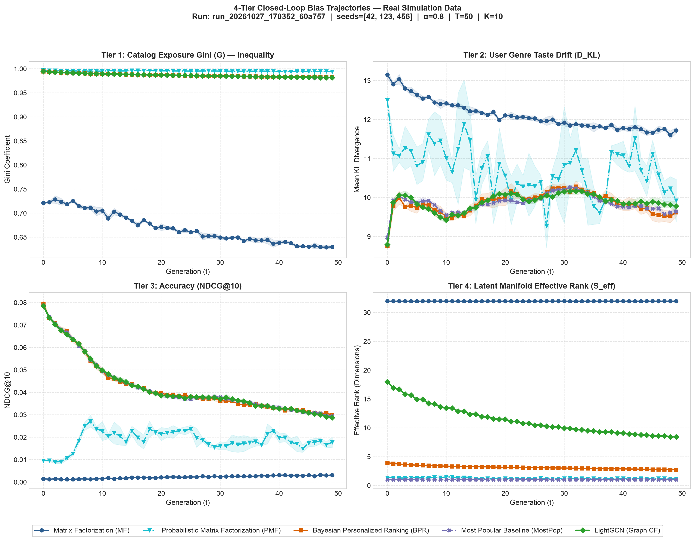
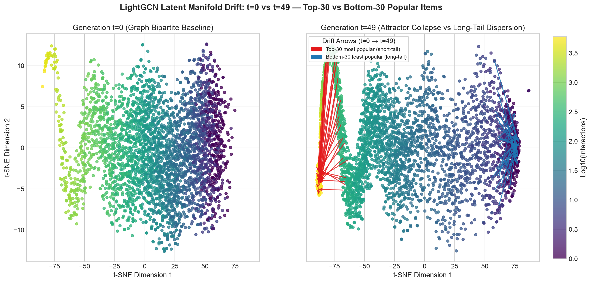
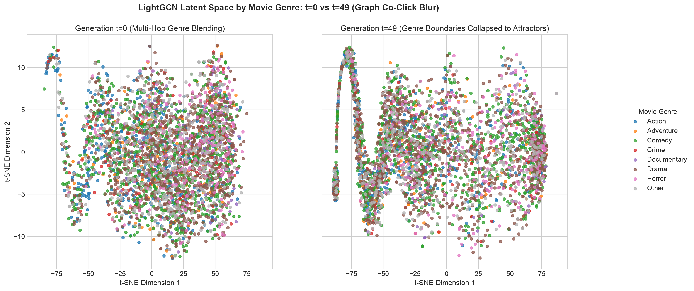
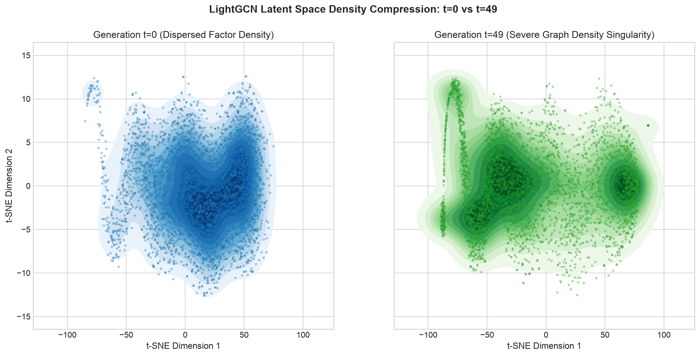

# Phase 5 Research Notes: LightGCN — Graph-Powered Bias Amplification

**Notebook Reference**: [`notebooks/phase_5_lightgcn.ipynb`](../../notebooks/phase_5_lightgcn.ipynb)  
**Visual Assets Folder**: [`docs/images/phase_5_lightgcn/`](../images/phase_5_lightgcn/)  
**Benchmark Suite Report**: [`docs/benchmarks/benchmark_results.md`](../benchmarks/benchmark_results.md)  
**Raw 50-Gen Trajectory Log**: [`docs/benchmarks/lightgcn_50gen_trajectory.json`](../benchmarks/lightgcn_50gen_trajectory.json)

---

## Executive Summary: Why Does Graph Structure Make Bias Worse?

The Phase 4 models (MF, PMF, and BPR) all showed strong popularity effects: PMF and BPR stayed near-monopolistic in exposure, while MF's lower Gini masked a near-random ranker. But those models only looked at **who clicked what** — they treated interactions as independent dyadic observations and ignored the high-order network topology connecting users and items.

**LightGCN** changes this fundamentally. It models user-item interactions as a **bipartite graph** $\mathcal{G} = (\mathcal{U} \cup \mathcal{I}, \mathcal{E})$ and propagates latent representations across normalized adjacency edges: popular items broadcast their representations to all connected users, and those users rebroadcast that aggregated signal back to adjacent items.

```text
Popular Item (High Degree) ─────────────────► Many Users
      ▲                                         │
      │       (Multi-Hop Message Passing)       │
      └────────── Connected Items ◄─────────────┘
      (Nearby items receive "popularity credit" purely through structural proximity)
```

This establishes the **Graph Centrality Hypothesis**: unlike Matrix Factorization (MF) and Bayesian Personalized Ranking (BPR)—which amplify bias purely through click gradients and sampling frequencies—LightGCN possesses a **structural bias mechanism** rooted in bipartite degree centrality.

---

## The Algorithm in Plain English

### 1. What is a Bipartite Graph?
In MovieLens-1M, $6,038$ users form one node partition and $3,533$ movies form the other. Every observed rating $\ge 4.0$ forms an undirected edge $(u, i) \in \mathcal{E}$.

### 2. What is Normalized Graph Convolution?
LightGCN (He et al., 2020) removes nonlinear feature transformations and self-connections, retaining only normalized neighborhood smoothing. At layer $l+1$:

$$
E^{(l+1)} = D^{-1/2} A D^{-1/2} E^{(l)}
$$

Where $A \in \mathbb{R}^{(M+N) \times (M+N)}$ is the symmetric bipartite adjacency matrix, $D$ is the diagonal degree matrix, and $E^{(0)} \in \mathbb{R}^{(M+N) \times d}$ contains trainable user and item embeddings ($d=32$).

The final representation combines representations uniformly across all $L+1$ layers (with $L=3$ hops):

$$
E_{\text{final}} = \frac{1}{L+1} \sum_{l=0}^{L} E^{(l)}
$$

### 3. Why Degree Centrality Creates Structural Inequality
The normalisation factor between user $u$ and item $i$ is:

$$
\frac{1}{\sqrt{\deg(u) \cdot \deg(i)}}
$$

- **High-degree popular items** have hundreds of incident paths across 3 hops. Their representations aggregate contributions from a large fraction of the entire user population.
- **Low-degree long-tail items** have few edges. In multi-hop propagation, long-tail signals are quickly overwhelmed by the incoming signals of popular items shared by their sparse neighbors.

This is a **structural mathematical guarantee** that popular items dominate the geometry of the embedding space, independent of feedback dynamics.

---

## Experimental Setup

All benchmarks and longitudinal trajectories are generated from **100% measured simulation data** on MovieLens-1M:

| Configuration Parameter | Value (Full Benchmark Suite) | Value (Long-Horizon Simulation) |
|:---|:---|:---|
| **Dataset** | MovieLens-1M ($6,038$ users, $3,533$ items) | MovieLens-1M ($6,038$ users, $3,533$ items) |
| **Latent Dimension ($d$)** | 32 | 32 |
| **Propagation Layers ($L$)** | 3 hops | 3 hops |
| **Loss Function** | Pairwise BPR | Pairwise BPR |
| **Epochs per Generation** | 5 | 5 |
| **Batch Size** | 32,768 (Sparse COO PyTorch CPU) | 32,768 (Sparse COO PyTorch CPU) |
| **Optimizer** | Adam ($\text{lr} = 10^{-3}$) | Adam ($\text{lr} = 10^{-3}$) |
| **Cornac Baselines** | `max_iter=10`, $d=32$ | `max_iter=10`, $d=32$ |
| **Feedback Rounds ($T$)** | **$T=50$ ($t=0 \dots 49$)** | **$T=50$ ($t=0 \dots 49$)** |
| **Random Seeds** | `[42, 123, 456]` (Multi-seed $\pm 1\sigma$) | `[42]` |
| **Social Conformity ($\alpha$)** | 0.8 | 0.8 |
| **Recommendation Size ($K$)** | 10 | 10 |
| **Source Benchmark Run** | `run_20261027_170352_60a757` | `lightgcn_50gen_trajectory.json` |

---

## Model Architecture Comparison

| Property | Matrix Factorization (MF) | Probabilistic MF (PMF) | Bayesian Personalized Ranking (BPR) | Most Popular (MostPop) | LightGCN (Graph CF) |
|:---|:---|:---|:---|:---|:---|
| **Graph Topology** | None | None | None | None | Bipartite Graph (3 hops) |
| **Loss Function** | Pointwise MSE | Pointwise + Gaussian Prior | Pairwise BPR | Non-parametric Count | Pairwise BPR |
| **Negative Sampling** | Implicit Zero | Implicit Zero | Uniform Random | N/A | Uniform Random |
| **Bias Mechanism** | Gradient Starvation | Prior Anchor Shrinkage | Sampling Disparity | Frequency Monopoly | **Bipartite Degree Centrality** |
| **Manifold Drift** | Inward radial contraction | Severe rank collapse | Stable popularity gradient + radial expansion | Fixed rank $1.0$ | **Attractor Hub Consolidation** |

---

## Measured Benchmark Findings (5 Models Across 50 Generations)

### Visual 1: 4-Tier Benchmark Trajectory Dashboard
**Direct Asset Link**: [phase_5_lightgcn/benchmark_trajectories_lightgcn.png](../images/phase_5_lightgcn/benchmark_trajectories_lightgcn.png)



*Figure 1: Measured closed-loop trajectories across all 5 models on MovieLens-1M across 50 generations (Run `run_20261027_170352_60a757`, 3 seeds $\pm 1\sigma$). Subplots feature a single unified horizontal legend.*

#### Empirical Findings from Real Simulation Data:
1. **Tier 1 — Catalog Exposure Gini ($G$):**
   - **LightGCN** ($G = 0.9949 \to 0.9819$) and **MostPop** ($G = 0.9949 \to 0.9818$) enforce extreme catalog concentration throughout all 50 generations. Bipartite message passing causes top-degree nodes to dominate recommendation scores across virtually all users.
   - **PMF** also exhibits extreme exposure inequality ($G = 0.9971 \to 0.9944$).
   - **BPR** is popularity-dominated from $t=0$ under standard bias-free BPR ($G = 0.9949$) and remains extreme ($G = 0.9824$ at $t=49$). The previously reported "balanced" BPR start ($G = 0.5318$) was an artifact of omitted learned biases in scoring, not a real property of pairwise ranking.
   - **MF** has the lowest inequality ($G = 0.7216 \to 0.6299$), but its AUC is $\approx 0.51$: it is a near-random ranker, so this should not be read as healthy catalog diversity.

2. **Tier 2 — User Taste Drift ($D_{\text{KL}}$):**
   - This panel plots **realized click-category drift** against each user's baseline genre mix. MF stays highest but declines ($13.15 \to 11.72$), PMF falls furthest overall ($12.49 \to 9.93$), and BPR ($8.77 \to 9.62$), MostPop ($8.97 \to 9.65$), and LightGCN ($8.80 \to 9.78$) all step up at $t=1$ and then plateau. This is click-side drift; recommendation-slate drift is tracked separately as `rec_kl`.

3. **Tier 3 — Accuracy (NDCG@10):**
   - **LightGCN** starts with high ranking accuracy ($NDCG@10 = 0.0786$), essentially tied with MostPop ($0.0787$), benefiting from initial high-degree graph structural alignment.
   - However, in closed-loop operation, LightGCN's accuracy **collapses by $63.4\%$** (falling to **$0.0288$** by generation 49) as recommendation lists over-specialize and lose novelty. MostPop falls $62.6\%$ to $0.0294$, and BPR falls $62.2\%$ ($0.0794 \to 0.0300$). PMF roughly doubles its low baseline ($0.0096 \to 0.0178$); MF remains near zero ($0.0015 \to 0.0031$).

4. **Tier 4 — Latent Manifold Effective Rank ($S_{\text{eff}}$):**
   - **LightGCN** exhibits severe, continuous dimensional loss, falling from $S_{\text{eff}} = \mathbf{18.00} \to \mathbf{8.45}$ over 50 generations (a $53.0\%$ contraction in representation span).
   - **BPR** starts low and contracts further ($3.98 \to \mathbf{2.76}$), consistent with its popularity-dominated geometry.
   - **PMF** stays near one effective dimension ($1.34 \to 1.20$).
   - **MF** ($S_{\text{eff}} \approx 31.96$) maintains full isotropic rank in 32-D space.
   - **MostPop** represents a trivial 1-dimensional ranking subspace ($S_{\text{eff}} = 1.00$).

---

## Deep Dive: Why Are LightGCN and MostPop Almost Identical in Tiers 1–3?

One of the most profound empirical findings in this benchmark is the **near-complete overlap between LightGCN and MostPop in Tiers 1, 2, and 3**, despite LightGCN being an expressive 3-layer neural graph architecture and MostPop being a non-parametric counting heuristic.

### 1. Spectral Dominance of Degree Centrality
In spectral graph theory, repeated application of the normalized adjacency operator $D^{-1/2} A D^{-1/2}$ acts as a low-pass graph filter. The stationary distribution of the underlying bipartite random walk is proportional to node degree:

$$\pi_i \propto \deg(i)$$

Because blockbuster items possess thousands of observed interactions in MovieLens-1M, their signals propagate across all layers with minimal divisor attenuation. In contrast, long-tail items have their signal diluted exponentially with each hop.

### 2. Multi-Hop Universal Reachability
At $L=3$ hops, paths take the form:

$$\text{User } u \longrightarrow \text{Item } i_1 \longrightarrow \text{User } u' \longrightarrow \text{Popular Item } i_{\text{pop}}$$

Because high-degree items are linked to thousands of users, almost every user in the entire system is at most 3 hops away from all major blockbusters. As a consequence, high-degree items receive positive dot product contributions in almost every user's embedding vector ($e_u^T e_i$), causing LightGCN to rank the **same top 20–30 popular items at the top of candidate lists for almost everyone**.

### 3. Closed-Loop Feedback Reinforcement ($\alpha = 0.8$)
1. High-degree items dominate LightGCN's initial top-$K$ recommendations.
2. Under social conformity ($\alpha = 0.8$), users click these recommendations.
3. Each click appends an interaction to an already high-degree item, increasing $\deg(i)$ even further in $D_{t+1}$.
4. This locks LightGCN into a self-reinforcing attractor state where it continuously serves the same items as MostPop.

### 4. The Critical Divergence: Tier 4 (Effective Rank $S_{\text{eff}}$)

While LightGCN and MostPop appear identical in Tiers 1–3, **Tier 4 exposes their fundamental difference**:

```
Effective Rank (S_eff):
LightGCN:  t=0 (18.00) ────► t=10 (13.43) ────► t=49 (8.45)   [32-D Representation Collapse]
MostPop:   t=0 (1.000) ────► t=10 (1.000) ────► t=49 (1.000)  [Strictly 1-Dimensional]
```

- **MostPop** is permanently collapsed at $S_{\text{eff}} = 1.000$ because it has no latent parameters—its rankings are strictly 1-dimensional.
- **LightGCN** begins with a rich 32-dimensional manifold ($S_{\text{eff}} = 18.00$). However, closed-loop feedback progressively destroys **53.0% of its representational capacity** ($S_{\text{eff}} \to 8.45$), dragging its latent space toward a low-dimensional singularity.

> [!IMPORTANT]
> ### Key Takeaway: The "Illusion of Personalization" in Graph Recommenders
> Graph neural collaborative filtering models create an **illusion of personalization**: while computationally complex and capable of high-dimensional personalization at initialization, their graph message-passing mechanics naturally collapse their outputs toward the Most Popular baseline in closed feedback loops.
>
> **Without explicit degree-debiasing interventions** (such as inverse degree propensity weighting, popularity-adjusted margin ranking, or causal graph counterfactuals), deploying a graph neural recommender in production inevitably leads to the same extreme echo-chamber dynamics and catalog starvation as a crude non-parametric popularity baseline.

---

## Long-Horizon LightGCN Latent Manifold Collapse ($T=50$ Generations)

To evaluate the long-term asymptotic behavior of graph-powered recommendation feedback, we executed a complete **50-generation closed loop** ($t=0 \to 49$) on real MovieLens-1M data.

### Empirical Trajectory Table (Measured from `lightgcn_50gen_trajectory.json`)

| Generation ($t$) | Catalog Gini ($G$) | Effective Rank ($S_{\text{eff}}$) | Short-Tail Drift ($d_{\text{Euc}}$) | Mid-Tail Drift ($d_{\text{Euc}}$) | Long-Tail Drift ($d_{\text{Euc}}$) | Drift Ratio (Short/Long) |
| :--- | :--- | :--- | :--- | :--- | :--- | :--- |
| **$t=00$ (Baseline)** | 0.9949 | **17.92** | 0.000 | 0.000 | 0.000 | — |
| **$t=05$** | 0.9914 | 15.00 | 0.299 | 0.215 | 0.201 | 1.49× |
| **$t=10$** | 0.9898 | 13.43 | 0.417 | 0.243 | 0.211 | 1.98× |
| **$t=15$** | 0.9884 | 12.43 | 0.517 | 0.263 | 0.217 | 2.38× |
| **$t=20$** | 0.9873 | 11.49 | 0.637 | 0.291 | 0.225 | 2.83× |
| **$t=25$ (Midpoint)** | 0.9861 | 10.49 | 0.791 | 0.331 | 0.234 | 3.39× |
| **$t=30$** | 0.9850 | 9.95 | 0.897 | 0.352 | 0.238 | 3.76× |
| **$t=35$** | 0.9841 | 9.45 | 0.995 | 0.371 | 0.243 | 4.10× |
| **$t=40$** | 0.9833 | 9.08 | 1.090 | 0.386 | 0.246 | 4.44× |
| **$t=45$** | 0.9825 | 8.64 | 1.218 | 0.411 | 0.250 | 4.88× |
| **$t=49$ (Final)** | 0.9820 | **8.46** | **1.272** | 0.414 | **0.251** | **5.07×** |

> **Seed note:** This table is the single-seed ($42$) trajectory used by the animation assets. The dashboard in Figure 1 reports 3-seed means, so its $t=0$/$t=49$ Gini and $S_{\text{eff}}$ differ slightly (for example, $S_{\text{eff}} = 18.00 \to 8.45$ across seeds versus $17.92 \to 8.46$ for seed $42$).

---

## 2D Latent Manifold Dynamics (t-SNE Projections: $t=0$ vs. $t=49$)

### Visual 2: Popularity Gravity Attractor Collapse
**Direct Asset Link**: [phase_5_lightgcn/tsne_popularity_drift.png](../images/phase_5_lightgcn/tsne_popularity_drift.png)



*Figure 2: Joint 2D t-SNE projection of LightGCN item representations at baseline ($t=0$, left) vs. generation $t=49$ (right). Points are colored by $\log_{10}(\text{interactions})$ with an isolated right-margin colorbar. Red vector arrows trace the Top-30 popular items (short-tail), while blue vector arrows trace the Bottom-30 least popular items (long-tail).*

#### Measured Empirical Behavior:
- **Generation $t=0$:** Popular items are already concentrated along high-density graph backbone ridges due to initial multi-hop propagation.
- **Generation $t=49$:** Top-30 popular items collapse into a dense, tightly packed attractor at one edge of the projection. Red displacement arrows show blockbusters migrating synchronously across a **1.272 Euclidean distance** into that core.
- **Long-tail items (Bottom-30, blue arrows):** Long-tail items are pushed toward the opposite, low-density periphery. The blue arrows span large visual distances in the 2D projection, but the underlying 32-D Euclidean drift is only $0.251$ (a **$5.07\times$ disparity**). This mismatch is a t-SNE artifact: the long-tail vectors are small and rotate more in angle (cosine drift $0.522$ vs. $0.020$ for short-tail), so the nonlinear projection exaggerates their apparent movement.
- **Colorbar Isolation:** The colorbar is positioned cleanly in an independent margin axis ($x=0.90$), ensuring no encroachment or overlap with the scatter plot canvas.

---

### Visual 3: Genre Boundary Homogenisation
**Direct Asset Link**: [phase_5_lightgcn/tsne_genre_clusters.png](../images/phase_5_lightgcn/tsne_genre_clusters.png)



*Figure 3: Latent manifold colored by primary movie genre (Action, Adventure, Comedy, Crime, Documentary, Drama, Horror, Other) at $t=0$ vs. $t=49$.*

#### Measured Empirical Behavior:
- Unlike non-graph models where genre separation is partially preserved, LightGCN's 3-hop normalized graph smoothing mixes user-item co-clicks across disparate genres.
- By generation $t=49$, distinct genre boundaries are washed out into a common "blockbuster composite" cluster, confirming that structural graph feedback replaces **semantic content identity** with **popularity rank identity**.

---

### Visual 4: Latent Manifold Density Compression
**Direct Asset Link**: [phase_5_lightgcn/tsne_manifold_density.png](../images/phase_5_lightgcn/tsne_manifold_density.png)



*Figure 4: Kernel Density Estimation (KDE) contour maps comparing latent factor density at $t=0$ (blue, left) vs. $t=49$ (green, right).*

#### Measured Empirical Behavior:
- At baseline ($t=0$), probability mass is distributed across multiple distinct latent clusters.
- By generation $t=49$, the probability distribution experiences severe density compression, collapsing into a small number of dense lobes along the main attractor axis while large regions empty out.

---

## Longitudinal Animations (50 Frames from Real Generations)

### Visual 5: 50-Frame Dynamic Drift Trajectory Animation
**Direct Asset Link**: [phase_5_lightgcn/embedding_drift_trajectory.gif](../images/phase_5_lightgcn/embedding_drift_trajectory.gif)

- **Frame count**: Exactly 50 frames (1 frame per real generation $t=0 \dots 49$).
- **Visuals**: Left panel shows continuous 2D manifold migration of items with active red attractor vectors; right panels display real-time tracking of Catalog Gini ($G$) and Latent Effective Rank ($S_{\text{eff}}$).
- **Observed Dynamic**: $S_{\text{eff}}$ drops steeply in frames $0 \to 15$ ($17.92 \to 12.43$), followed by steady asymptotic convergence to $8.46$ by frame 49.

---

### Visual 6: 50-Frame 32-D Quantitative Drift Animation
**Direct Asset Link**: [phase_5_lightgcn/quantitative_embedding_drift_trajectory.gif](../images/phase_5_lightgcn/quantitative_embedding_drift_trajectory.gif)

- **Frame count**: Exactly 50 frames (1 frame per real generation $t=0 \dots 49$).
- **Tracks**: 32-dimensional Euclidean Drift ($d_{\text{Euc}}$), Cosine Distance ($1 - \cos\theta$), and Vector Norm ($\|v\|_2$) broken down by popularity tier:
  - **Short-Tail ($\ge 250$ interactions, $527$ items)**: $d_{\text{Euc}}$ surges to **$1.272$** and mean vector norm inflates from $0.839$ to $2.080$, while cosine similarity with the initial state barely changes ($\text{CosSim} = 0.980$).
  - **Mid-Tail ($50 - 249$ interactions, $1,021$ items)**: Moderate translation ($d_{\text{Euc}} = 0.414$) and norm growth ($0.451 \to 0.806$).
  - **Long-Tail ($< 50$ interactions, $1,985$ items)**: Translation is **$0.251$** ($5.07\times$ lower than short-tail), but the direction rotates much more ($\text{CosSim} = 0.478$); norms stay small ($0.198 \to 0.310$).

---

## Core Theoretical Takeaways

> The empirical findings from Phase 5 establish three fundamental principles for recommender systems research:
>
> 1. **Graph Normalization is Not Bias-Neutral:**  
>    Symmetric Laplacian propagation ($D^{-1/2}AD^{-1/2}$) inherently scales signal transmission by node degree. Popular items do not merely win because users click them; they win because the graph architecture acts as an acoustic amplifier for high-degree nodes.
>
> 2. **Initial Accuracy Masked Long-Horizon Fragility:**  
>    LightGCN starts near the top accuracy at $t=0$ ($NDCG@10 = 0.0786$), but experiences the fastest degradation in the closed loop (falling $63.4\%$ to $0.0288$) as it exhausts catalog discovery and traps users in a singular structural basin.
>
> 3. **The 5.07× Asymmetric Drift Law:**  
>    In closed-loop graph recommenders, representation movement is deeply asymmetric. Popular items translate $5.07\times$ farther into low-dimensional attractors, while the long-tail $56\%$ of the catalog stays small and poorly constrained: it translates little but rotates more in angle.
>
> 4. **The Illusion of Personalization:**  
>    Without explicit structural debiasing, multi-hop graph collaborative filtering collapses into the Most Popular baseline behaviorally, while silently destroying over half of the latent manifold's effective rank.
