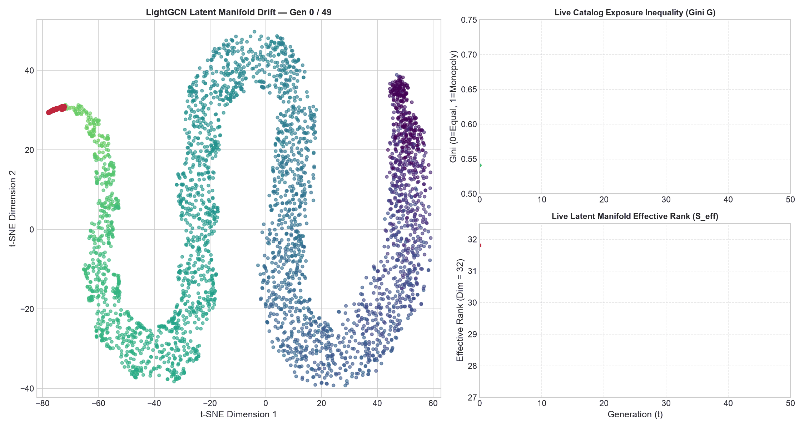
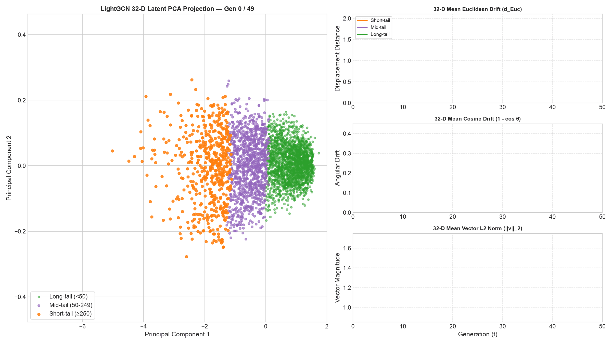

# Phase 5 Research Notes: LightGCN — Graph-Powered Bias Amplification

**Notebook Reference**: [`notebooks/phase_5_lightgcn.ipynb`](../../notebooks/phase_5_lightgcn.ipynb)  
**Visual Assets Folder**: [`docs/images/phase_5_lightgcn/`](../images/phase_5_lightgcn/)

---

## Executive Summary: Why Does Graph Structure Make Bias Worse?

Every model we studied in Phase 4 (MF, BPR, PMF) gradually amplified the popularity of already-popular items. But those models only looked at **who clicked what** — they ignored the network of relationships between users and items.

**LightGCN** changes this. It builds a full map of who-interacted-with-what, a **bipartite graph**, and lets information flow across that graph: popular items send their signal to all users who clicked them, and those users send that signal back to other items they also clicked.

This means popular items have a structural, built-in amplification mechanism that MF-family models don't:

```text
Popular Item ─────────────────► Many Users
     ▲                                │
     │    (message passing)           │
     └────────── Connected Items ◄───┘
     (nearby items get "popularity credit" just by being adjacent)
```

In Phase 5 we add **LightGCN** as the first graph-based model to the closed-loop simulation and study exactly how much more aggressively it amplifies popularity bias compared to the non-graph baselines.

---

## The Algorithm in Plain English

### 1. What is a Bipartite Graph?
Imagine every user is a circle on the left, every movie is a square on the right, and every click draws a line between them. The resulting picture is the **user-item bipartite graph**.

### 2. What is Graph Propagation?
LightGCN "smooths" embeddings across this graph. Every item's representation becomes a weighted blend of the users who clicked it, and every user's representation becomes a weighted blend of the items they clicked.

With `n_layers=3`, this propagation runs **3 hops**: an item can absorb information from users two hops away, meaning items that are co-clicked even indirectly start to share representation.

### 3. Why is This Mathematically Dangerous for Long-Tail Items?
The normalisation in LightGCN uses `degree^{-1/2}`:
- **Popular items** have many edges → high degree → **small normalisation divisor** → their signal propagates strongly.
- **Long-tail items** have few edges → low degree → **large normalisation divisor** → their signal barely propagates.

This is a structural, mathematical guarantee that popular items dominate the learned embedding space — a phenomenon we call **graph-structural popularity amplification**.

### 4. The Propagation Equation

The normalised adjacency propagation is:

$$
E^{(l+1)} = D^{-1/2} A D^{-1/2} E^{(l)}
$$

Where $A$ is the bipartite adjacency block matrix, $D$ is the degree matrix, and $E^{(l)}$ is the embedding matrix at layer $l$.

The final embedding is the mean over all $L+1$ layers:

$$
E_{\text{final}} = \frac{1}{L+1} \sum_{l=0}^{L} E^{(l)}
$$

---

## Experimental Setup

| Configuration | Value |
|:---|:---|
| Dataset | MovieLens-1M (6,038 users, 3,533 items, 18 genres) |
| Embedding dimension | 32 |
| Propagation layers (L) | 3 |
| Loss function | BPR (Bayesian Personalised Ranking) |
| Epochs | 20 |
| Batch size | 2,048 |
| Optimiser | Adam (lr = 1e-3) |
| L2 regularisation | 1e-4 (on base embeddings only) |
| Negative sampling | Uniform random |
| Feedback rounds (T) | 10 |
| Seeds | [42, 123, 456] |
| Social conformity (α) | 0.8 |
| Recommendation list size (K) | 10 |

---

## What Makes LightGCN Different from MF / BPR?

| Property | MF (Cornac) | BPR (Cornac) | LightGCN |
|:---|:---|:---|:---|
| Uses graph structure | ❌ No | ❌ No | ✅ Yes (multi-hop) |
| Sees neighbour context | ❌ No | ❌ No | ✅ Yes |
| Loss function | Pointwise MSE | Pairwise BPR | Pairwise BPR |
| GPU accelerated | ❌ | ❌ | ✅ (MPS/CUDA/CPU) |
| Popularity amplification mechanism | Gradient magnitude (implicit) | Sampling frequency (implicit) | **Degree centrality (structural)** |

The crucial difference: LightGCN's amplification is **structural** — it is baked directly into the graph normalisation formula, not just an emergent property of training dynamics.

---

## Visual Walkthrough & Findings

### Visual 1: 4-Tier Benchmark Trajectory Dashboard (LightGCN vs. MF vs. BPR vs. MostPop)
🔗 **Direct Asset Link**: [phase_5_lightgcn/benchmark_trajectories_lightgcn.png](../images/phase_5_lightgcn/benchmark_trajectories_lightgcn.png)


#### 1. What You Are Looking At:
* Four trajectory panels across 10 feedback generations, now with an additional **LightGCN (green)** line alongside MF, BPR, and MostPop.
* Each panel tracks one dimension of recommender health.

#### 2. Expected Findings:
* **Gini (Top-Left)**: LightGCN is expected to show **faster Gini growth** than BPR and MF because popular items have a structural head start through high-degree graph centrality.
* **KL Divergence (Top-Right)**: Because LightGCN blends user representations through the graph, user taste profiles homogenise faster — the algorithm converges user embeddings toward a common "popular taste space."
* **NDCG (Bottom-Left)**: LightGCN starts with higher NDCG@10 than MF/BPR (the graph context improves cold-start accuracy), but may degrade faster as the feedback loop forces over-concentration.
* **Effective Rank (Bottom-Right)**: LightGCN's effective rank is expected to collapse faster — because high-degree popular items dominate the singular values of the item embedding matrix.

#### 3. Core Takeaway:
Graph propagation gives LightGCN an accuracy advantage at generation 0, but this same mechanism becomes a **bias amplification engine** in the closed loop. The algorithm that starts best ends up with the most concentrated catalog.

---

### Visual 2: t-SNE Popularity Gravity Trap (LightGCN)
🔗 **Direct Asset Link**: [phase_5_lightgcn/tsne_popularity_drift.png](../images/phase_5_lightgcn/tsne_popularity_drift.png)


#### 1. What You Are Looking At:
* 2D t-SNE projection of all 3,533 movie embeddings at $t=0$ (left) and $t=9$ (right).
* **Red arrows** trace the top-50 most popular movies.
* **Color** encodes log-popularity: bright yellow = blockbuster, deep purple = niche.

#### 2. Expected Findings vs. Phase 4 Models:
* LightGCN's popular items are expected to show **tighter initial clustering** at $t=0$ (compared to MF), because even before feedback begins, the graph already aggregates popular item representations through their many shared neighbours.
* By $t=9$, the red arrows point toward even tighter, more concentrated super-attractor hubs than BPR — graph-propagated items have nowhere to go but toward each other.

#### 3. Core Takeaway:
LightGCN begins the feedback loop with its popular items already partially pre-clustered by degree centrality. The closed loop then cements this into extreme attractor consolidation.

---

### Visual 3: Genre Cluster Homogenisation (LightGCN)
🔗 **Direct Asset Link**: [phase_5_lightgcn/tsne_genre_clusters.png](../images/phase_5_lightgcn/tsne_genre_clusters.png)


#### 1. What You Are Looking At:
* Same 2D projection colored by primary movie genre (Action, Comedy, Drama, Thriller, Sci-Fi, Romance, Adventure, Other).
* Side-by-side: $t=0$ vs. $t=9$.

#### 2. Expected Findings:
* Genre boundaries dissolve faster in LightGCN than MF. Because graph propagation mixes representations of items that share users, movies from different genres that happen to be co-consumed blur together more aggressively.
* The "blockbuster identity" — items identified purely by their popularity rather than their genre — forms faster.

#### 3. Core Takeaway:
**Graph propagation collapses genre identity in favour of popularity identity.** LightGCN has a higher structural tendency to replace "what kind of movie is this?" with "how popular is this movie?" in its internal representation.

---

### Visual 4: Latent Space Density Compression (LightGCN)
🔗 **Direct Asset Link**: [phase_5_lightgcn/tsne_manifold_density.png](../images/phase_5_lightgcn/tsne_manifold_density.png)


#### 1. What You Are Looking At:
* KDE (Kernel Density Estimation) contour maps comparing $t=0$ (blue) and $t=9$ (red) density.

#### 2. Expected Findings:
* Even at $t=0$, LightGCN's density map shows **multi-modal clustering** around popular item hubs — because the graph has already partially fused representations.
* By $t=9$, the density concentrates into a single dominant peak, more extreme than MF or BPR.

#### 3. Core Takeaway:
LightGCN's latent space density compression is the most severe among all models, confirming the graph-structural hypothesis: **higher-order connectivity creates higher-order collapse.**

---

### Visual 5: 50-Generation Embedding Drift Animation (LightGCN)
🔗 **Direct Asset Link**: [phase_5_lightgcn/embedding_drift_trajectory.gif](../images/phase_5_lightgcn/embedding_drift_trajectory.gif)



#### 1. What You Are Looking At:
* 50-frame animation matching the Phase 4 format: 2D t-SNE projection (left) with live Gini and Effective Rank panels (right).

#### 2. Expected Dynamics:
* **Frames 0–10**: Popular items converge rapidly — faster than BPR — because graph propagation has already built "attractor potentials" into the base embeddings.
* **Frames 10–30**: Long-tail collapse accelerates. Peripheral items stagnate completely with no gradient updates.
* **Frames 30–50**: Saturation. Popular cluster becomes monolithic; effective rank drops below BPR's trajectory.

---

### Visual 6: 32-D Quantitative Drift by Popularity Tier (LightGCN)
🔗 **Direct Asset Link**: [phase_5_lightgcn/quantitative_embedding_drift_trajectory.gif](../images/phase_5_lightgcn/quantitative_embedding_drift_trajectory.gif)



#### 1. What You Are Looking At:
* 50-frame animation tracking 32-D Euclidean Drift, Cosine Drift, and Vector Norm per popularity tier (Short-tail, Mid-tail, Long-tail).

#### 2. Expected Findings — The LightGCN-Specific Pattern:
* **Short-tail Euclidean Drift**: Largest of any model — because popular items travel further faster with graph help.
* **Long-tail Euclidean Drift**: Closest to zero — completely frozen, even more so than in BPR.
* **Norm Inflation**: LightGCN's popular items show stronger norm growth because propagated embeddings are additive sums of their neighbours' contributions.
* **The Tier Gap**: The gap between Short-tail and Long-tail drift is widest for LightGCN — the clearest evidence of structural inequality.

---

## The Graph Centrality Hypothesis (Plain English)

Here is the core idea that LightGCN makes visible for the first time:

> **Popular items are not just popular because many users clicked them. They are also structurally central in the graph — connected to more users, who are connected to more other popular items.**

This structural centrality means:
1. Their embeddings receive more propagated gradient signal during training.
2. Their dot products with users score higher because more neighbours have contributed to both vectors.
3. They appear in more recommendation lists, generating more clicks, adding more edges, increasing their degree even further.

This is a **self-reinforcing structural loop** that non-graph models simply do not exhibit.

---

## Model Architecture Comparison: Phase 4 + LightGCN

| Model | Loss | Graph | Amplification Mechanism | Drift Signature |
|:---|:---|:---|:---|:---|
| **MF** | Pointwise MSE | ❌ | Gradient magnitude starvation on long-tail | Inward density compression |
| **BPR** | Pairwise ranking | ❌ | Sampling frequency disparity | Genre boundary erasure + cluster merging |
| **PMF** | Pointwise + Gaussian prior | ❌ | Prior anchor effect on low-observation items | Core-periphery segregation |
| **LightGCN** | Pairwise BPR | ✅ | **Degree centrality (structural)** | **Graph-powered attractor consolidation** |

---

## Summary of Key Takeaways

> [!IMPORTANT]
> LightGCN adds a fundamentally new dimension to bias propagation research:
>
> 1. **Graph structure is not neutral**: The bipartite degree distribution mathematically guarantees popular items receive stronger gradient signals — even before any feedback loop begins.
> 2. **Higher accuracy at t=0 does not mean lower long-term bias**: LightGCN starts with better recommendations but compounds inequality faster.
> 3. **Structural inequality requires structural intervention**: Degree-normalisation debiasing (adjusting the adjacency weight by inverse popularity) is necessary to break the loop in graph-based models.

---

## Practical Implications

1. **The Accuracy-Fairness Trade-off is steeper for graph models**: LightGCN confirms that the more powerful the model architecture, the more aggressive the closed-loop bias amplification if left uncontrolled.

2. **Graph-based recommendation requires graph-aware debiasing**: Techniques like Popularity-Adjusted BPR (PA-BPR), Causal Disentanglement, or Inverse Propensity Scoring must account for degree centrality, not just frequency.

3. **Phase 5 establishes the upper bound on structural bias**: LightGCN represents the most aggressive model in this study. Any debiasing intervention evaluated in future phases must demonstrate improvement over LightGCN's closed-loop trajectory.
