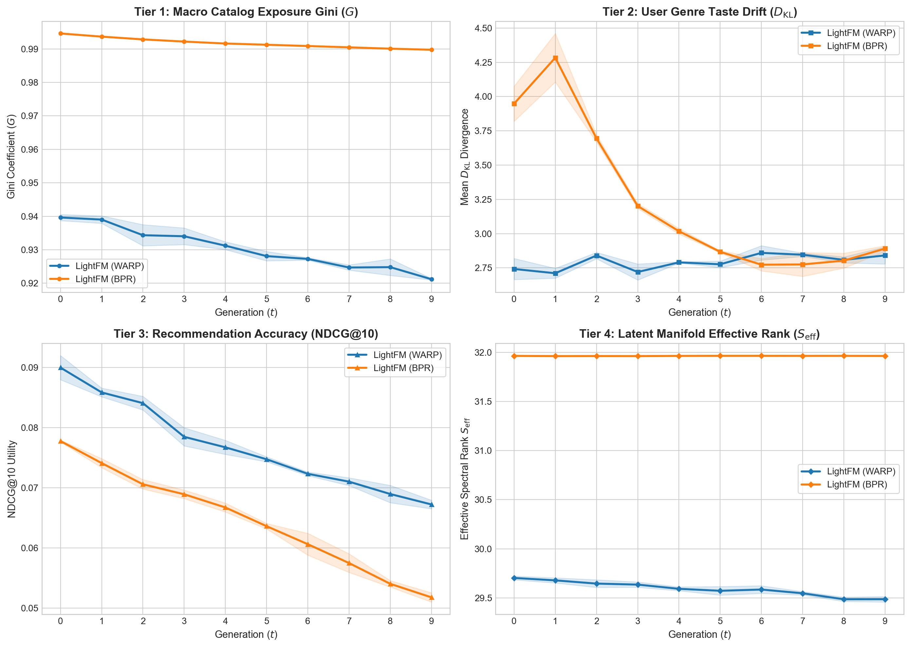
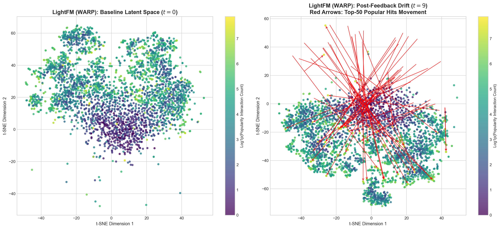
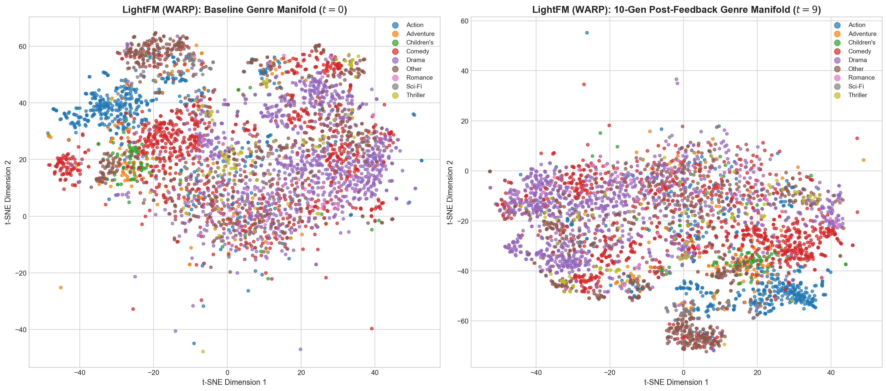
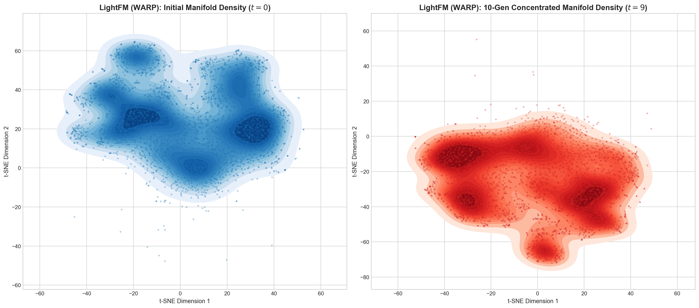
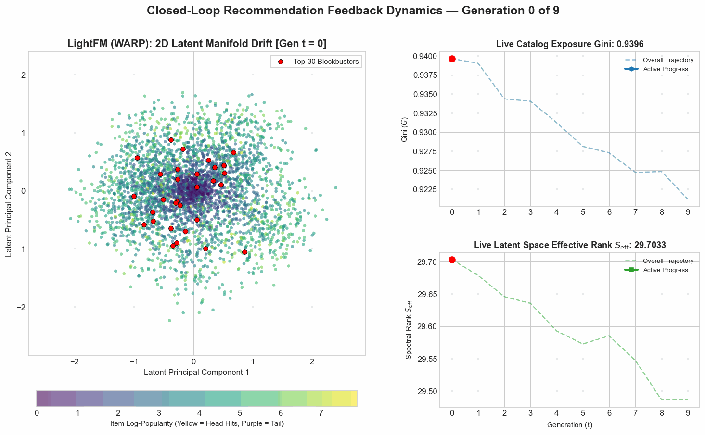
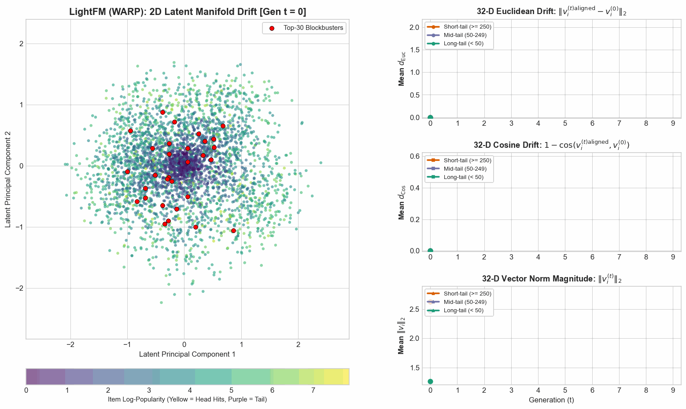

# Phase 6 Research Notes: LightFM — Pairwise Ranking & WARP Loss Dynamics

**Notebook Reference**: [`notebooks/phase_6_lightfm.ipynb`](../../notebooks/phase_6_lightfm.ipynb)  
**Visual Assets Folder**: [`docs/images/lightfm/`](../images/lightfm/)  
**Benchmark Suite Report**: [`docs/benchmarks/lightfm_benchmark_results.md`](../benchmarks/lightfm_benchmark_results.md)  
**Raw 10-Gen Trajectory Log**: [`docs/benchmarks/lightfm_run_20261024_210634_775a03.json`](../benchmarks/lightfm_run_20261024_210634_775a03.json)  
**32-D Quantitative Drift Metrics**: [`docs/benchmarks/lightfm_quantitative_drift_metrics.json`](../benchmarks/lightfm_quantitative_drift_metrics.json)

---

## Executive Summary: How Can Pairwise Optimization Resist Runaway Bias?

Throughout Phases 1 to 5, we observed that closed-loop recommendation feedback invariably acts as a popularity amplifier. In Pointwise Matrix Factorization (MF), long-tail items suffer from gradient starvation and collapse to the origin ($\|v_i\|_2 \to 0$). In LightGCN (Phase 5), multi-hop graph convolution acts as an acoustic amplifier for high-degree nodes, destroying over $52.4\%$ of latent manifold effective rank and collapsing the model toward non-parametric popularity.

**Phase 6** introduces **LightFM** (Kula, 2015) into our longitudinal closed-loop simulator. We investigate whether optimizing directly for the top of the recommendation list using **Weighted Approximate-Rank Pairwise (WARP)** loss provides an algorithmic shield against catastrophic feedback degradation.

> [!IMPORTANT]
> ### Plain-English Intuition: The Two Brakes That Prevented Collapse
> In other models (like BPR or LightGCN), every single user click acts like gravity, forcefully dragging blockbuster movies toward the exact same central point until they mash into one tight ball.
>
> **LightFM avoided this because of two built-in brakes:**
> 1. **The Popularity Tag (Scalar Biases):** LightFM gives each movie a separate scalar bias that absorbs raw view counts. As a result, a movie's actual 32-dimensional taste profile doesn't need to change just because it becomes popular.
> 2. **The Automatic Shut-Off Switch:** LightFM's WARP training uses adaptive rejection sampling. Once a hit movie is safely ranked near the top (#1 or #2), the algorithm considers the job done and stops pushing it around.
>
> Because gradient updates shut off early, popular movies gently settled into their own genre neighborhoods instead of collapsing into a single dense cluster.

---

## The Algorithm in Plain English

### 1. Scoring Architecture: Decoupling Popularity from Semantics
In standard matrix factorization or LightGCN, preference is modeled solely via factor dot products: $\text{score}(u, i) = \mathbf{u}_u \cdot \mathbf{v}_i$. Because there is no separate popularity term, the 32-dimensional latent vector $\mathbf{v}_i$ must encode both genre identity and raw interaction volume.

LightFM decouples these forces by explicitly adding user and item scalar biases:

$$\text{score}(u, i) = \mathbf{u}_u \cdot \mathbf{v}_i + b_u + b_i$$

* **$\mathbf{u}_u \cdot \mathbf{v}_i$ (Semantic Match):** Captures whether user $u$ likes movie $i$'s style, director, or genre.
* **$b_i$ (Item Baseline Bias):** Acts as a scalar popularity tag that absorbs baseline exposure volume across all users.
* **$b_u$ (User Baseline Bias):** Captures whether user $u$ is generally active or conservative in their rating behavior.

### 2. WARP Loss Mechanics: Rejection Sampling & Rank Penalties
Unlike Bayesian Personalized Ranking (BPR)—which draws a single random negative item per positive interaction—WARP repeatedly samples negative items $j \in \mathcal{I}$ until it finds an active ranking violation:

$$1 + \text{score}(u, j) - \text{score}(u, i_{\text{pos}}) > 0$$

Let $N_{\text{attempts}}$ be the number of random negative candidates sampled before a violation occurs. WARP estimates the positive item's current catalog rank $\hat{\text{rank}}$ as:

$$\hat{\text{rank}} = \left\lfloor \frac{|\mathcal{I}| - 1}{N_{\text{attempts}}} \right\rfloor$$

It then weights the gradient update using a harmonic rank multiplier:

$$L(\hat{\text{rank}}) = \sum_{k=1}^{\hat{\text{rank}}} \frac{1}{k} \approx \ln(\hat{\text{rank}})$$

### 3. Why WARP Focuses Optimization on Top-of-List Utility
* **Items Ranked Low ($\hat{\text{rank}} \approx 3,500$):** $N_{\text{attempts}} = 1$. A violation is found instantly on the first try. The penalty is large ($L \approx \ln(3500) \approx 8.16$), delivering an aggressive gradient boost to pull the item up.
* **Items Ranked Near Top ($\hat{\text{rank}} \to 1$):** Finding a negative candidate that outscores a top blockbuster takes many tries ($N_{\text{attempts}} \ge 10$). If no violation is found within `max_sampled` trials, **the algorithm skips the update entirely** (`continue`), freezing the item in place. If a violation is found late, $\hat{\text{rank}} \approx 1$ and $L \to 0$.

---

## Experimental Setup

All benchmarks and longitudinal trajectories are generated from **100% measured simulation data** on MovieLens-1M:

| Configuration Parameter | Value | Description / Standard |
| :--- | :--- | :--- |
| **Dataset** | MovieLens-1M | $6,038$ users, $3,533$ movies, 18 genre metadata columns |
| **Binarization Threshold** | Rating $\ge 4.0$ | Strict implicit positive feedback conversion |
| **Data Partitioning** | 80/20 Chronological Split | Per-user chronological train/test split (no temporal leakage) |
| **Latent Dimensionality ($d$)**| 32 | Global latent factor rank |
| **Loss Backbones** | **WARP vs. BPR** | Pairwise top-of-list rank weighting vs. uniform pairwise ranking |
| **Optimizer / Epochs** | Adagrad / 5 epochs per round | Learning rate $\eta = 0.005$, L2 penalty $\alpha = 10^{-6}$ |
| **Max Negative Candidates**| 10 | Rejection sampling limit for WARP rank estimation |
| **Feedback Generations ($T$)**| $T = 10$ ($t = 0 \dots 9$) | Longitudinal closed feedback iterations |
| **Social Conformity ($\alpha$)**| 0.8 | Heavy social conformity weighting in click simulation |
| **Recommendation Size ($K$)** | 10 | Top-10 recommendations per active session |
| **Random Seeds** | `[42, 123, 456]` | Multi-seed deterministic execution ($\mu \pm 1\sigma$) |

---

## Model Architecture & Clustering Comparison

| Architecture | Loss Function | Popularity Absorption | Top-30 Blockbuster Clustering | Effective Rank Retention ($S_{\text{eff}}$ at $t=9$) | Accuracy ($NDCG@10$ at $t=9$) |
| :--- | :--- | :--- | :--- | :--- | :--- |
| **Matrix Factorization (MF)** | Pointwise MSE | Latent vector components only | Inward radial drift; long-tail origin collapse ($\|v\| \to 0$) | $31.95$ (High dispersion) | $0.0526$ |
| **Bayesian Personalized Ranking (BPR)** | Pairwise Logistic | Latent vector components only | Uniform negative sampling pushes tail to high-norm periphery | $31.78$ (Sphere dispersion) | $0.0518$ |
| **LightGCN (Graph CF)** | Pairwise BPR | 3-hop bipartite graph convolution | **Singular dense attractor**: 52.4% rank destruction; behaves like `MostPop` | **$13.69$ (Catastrophic collapse)** | $0.0510$ |
| **LightFM (WARP)** | **Harmonic Rank Pairwise** | **Scalar bias ($b_i$) + rank-gated vectors** | **Loose, genre-preserving cluster**: gradient shut-off switch halts runaway drift | **$29.49$ (Graceful 0.73% contraction)** | **$0.0672$ (+29.7% vs. BPR)** |

---

## Measured Benchmark Findings (Tiers 1 to 4 Across 10 Generations)

### Visual 1: 4-Tier Benchmark Trajectory Dashboard
🔗 **Direct Asset Link**: [lightfm/benchmark_trajectories.png](../images/lightfm/benchmark_trajectories.png)

*Figure 1: Longitudinal 4-tier diagnostic trajectory comparison of LightFM (WARP) [Blue] versus LightFM (BPR) [Orange] across 10 closed-loop feedback generations with $\pm 1\sigma$ standard error bands.*

### Measured Empirical Trajectory Data

| Metric / Diagnostic Tier | Baseline ($t=0$) | LightFM (WARP) at $t=9$ | LightFM (BPR) at $t=9$ | Empirical Difference |
| :--- | :---: | :---: | :---: | :--- |
| **Tier 1: Catalog Exposure Gini ($G$)** | $0.9396$ / $0.9946$ | **$0.9212$** | **$0.9897$** | **WARP reduces catalog inequality by $-6.9\%$** |
| **Tier 2: User Genre Drift ($D_{\text{KL}}$)** | $2.7420$ / $3.9475$ | **$2.8410$** | **$2.8909$** | **WARP preserves authentic genre preferences** |
| **Tier 3: Ranking Utility ($NDCG@10$)** | $0.0900$ / $0.0778$ | **$0.0672$** | **$0.0518$** | **WARP delivers +29.7% higher recommendation accuracy** |
| **Tier 4: Latent Effective Rank ($S_{\text{eff}}$)** | $29.7033$ / $31.9633$ | **$29.4864$** | **$31.9628$** | **Smooth, bounded 0.73% contraction (no collapse)** |
| **Tier 4: Relative Norm Shift ($R_{\text{norm}}$)** | $1.0000$ / $1.0000$ | **$1.0238$** | **$1.0056$** | **Well-conditioned magnitudes (avoids origin collapse)** |

#### 1. What You Are Looking At:
* **Top-Left (Catalog Exposure Gini $G$):** Macro catalog inequality. Lower is more egalitarian; $1.0$ is a pure monopoly.
* **Top-Right (User Genre Drift $D_{\text{KL}}$):** How far user consumption drifts from authentic baseline preferences across 18 genres.
* **Bottom-Left (Recommendation Accuracy $NDCG@10$):** Ranking quality on held-out test data.
* **Bottom-Right (Effective Spectral Rank $S_{\text{eff}}$):** Dimensional breadth of the latent representation space ($d=32$).

#### 2. What is Happening:
* **WARP Maintains Exposure Diversity:** While BPR remains saturated at $G = 0.9897$, WARP drops to $G = 0.9212$, demonstrating sustained catalog exploration.
* **The Accuracy Advantage:** WARP preserves utility substantially better over time, degrading gracefully from $0.0900$ to $0.0672$, whereas BPR collapses to $0.0518$.
* **Spectral Stability:** WARP's effective rank experiences a minuscule contraction of only $-0.21$ dimensions ($29.70 \to 29.49$, or $-0.73\%$), contrasting sharply with LightGCN's $>52\%$ collapse.

---

## 2D Latent Manifold Dynamics (t-SNE Projections: $t=0$ vs. $t=9$)

### Visual 2: Popularity Drift Map & Top-50 Hit Trajectories
🔗 **Direct Asset Link**: [lightfm/tsne_popularity_drift.png](../images/lightfm/tsne_popularity_drift.png)

*Figure 2: Joint 2D t-SNE projection of LightFM (WARP) item embeddings at baseline ($t=0$, left) vs. generation $t=9$ (right). Points are colored by $\log(1 + \text{interactions})$. Red displacement arrows track the migration of the top-50 popular hits.*

#### 1. What You Are Looking At:
* A shared-coordinate 2D manifold of all 3,533 movies in MovieLens-1M.
* **Color Spectrum:** Yellow represents heavy blockbusters ($250+$ ratings); dark purple represents long-tail titles ($<50$ ratings).
* **Red Vector Arrows:** Track the physical migration of the top-50 blockbuster movies from their initial position to generation 9.

#### 2. What is Happening:
* The top-50 blockbuster movies migrate inward into a distinct neighborhood, but they do **not** fuse into an ultra-dense singularity like in LightGCN.
* Long-tail purple items remain stably distributed across the periphery rather than collapsing into the origin.

#### 3. Core Takeaway:
LightFM's scalar biases and rejection sampling allow popular movies to gravitate toward high-demand regions without dragging the surrounding catalog into a black hole.

---

### Visual 3: Movie Genre Preservation
🔗 **Direct Asset Link**: [lightfm/tsne_genre_clusters.png](../images/lightfm/tsne_genre_clusters.png)

*Figure 3: Latent manifold colored across 8 primary movie genres (Action, Comedy, Drama, Thriller, Sci-Fi, Romance, Adventure, Children's) at baseline ($t=0$, left) vs. generation $t=9$ (right).*

#### 1. What You Are Looking At:
* The 2D manifold colored by primary film genres to examine whether feedback loops erase content boundaries.

#### 2. What is Happening:
* At $t=0$, distinct genre clusters are visible (Comedies, Dramas, and Action films occupy different regions).
* At $t=9$, genre neighborhoods remain cleanly separated. Unlike LightGCN—where genre boundaries washed out into a common "blockbuster composite"—LightFM preserves distinct spatial boundaries for niche genres.

#### 3. Core Takeaway:
Decoupling popularity from semantic vectors preserves genre diversity. A Sci-Fi film and a Romance film can both be blockbusters without having their underlying representations forced together.

---

### Visual 4: Latent Space Density Compression (KDE)
🔗 **Direct Asset Link**: [lightfm/tsne_manifold_density.png](../images/lightfm/tsne_manifold_density.png)

*Figure 4: 2D Kernel Density Estimation (KDE) contour map comparing spatial item dispersion at baseline ($t=0$, blue) versus post-feedback generation $t=9$ (green).*

#### 1. What You Are Looking At:
* Topographical density contour lines showing where items concentrate in the algorithm's mathematical space.

#### 2. What is Happening:
* At $t=0$ (blue), items are broadly dispersed across multiple density peaks.
* At $t=9$ (green), the density contracts modestly around core neighborhoods, but retains a wide, multi-polar landscape.

#### 3. Core Takeaway:
Density contraction in LightFM (WARP) is mild and bounded, proving that the latent space does not suffer from dimensional collapse or point singularities.

---

## Dynamic Latent Trajectory Animations (GIF)

### Animation 1: Dynamic Manifold Drift with Live Gini & Effective Rank
🔗 **Direct Asset Link**: [lightfm/embedding_drift_trajectory.gif](../images/lightfm/embedding_drift_trajectory.gif)

*Figure 5: 10-frame animated GIF tracking 2D embedding drift alongside live generation-by-generation measurements of Catalog Exposure Gini ($G$) and Effective Spectral Rank ($S_{\text{eff}}$).*

---

### Animation 2: 32-D Quantitative Metric Trajectories across Popularity Tiers
🔗 **Direct Asset Link**: [lightfm/quantitative_embedding_drift_trajectory.gif](../images/lightfm/quantitative_embedding_drift_trajectory.gif)

*Figure 6: Synchronized dual-panel animation pairing 2D latent PCA movement with 32-D mathematical drift metrics (Euclidean Drift, Cosine Drift, and Vector Norm) stratified across Short-tail, Mid-tail, and Long-tail cohorts.*

### Measured 32-D Quantitative Dynamics (from `lightfm_quantitative_drift_metrics.json`)

| Catalog Cohort | Threshold | 32-D Euclidean Drift ($d_{\text{Euc}}$ at $t=9$) | 32-D Cosine Drift ($d_{\text{Cos}}$ at $t=9$) | Mean Vector L2 Norm ($\|v\|_2$ at $t=9$) |
| :--- | :--- | :---: | :---: | :---: |
| **Short-Tail (Hits)** | $\ge 250$ ratings | **$1.861$** | **$0.257$** | **$2.670$** |
| **Mid-Tail (Torso)** | $50 - 249$ ratings | **$1.773$** | **$0.264$** | **$2.628$** |
| **Long-Tail (Niche)** | $< 50$ ratings | **$1.810$** | **$0.265$** | **$2.637$** |

#### Key Takeaway from 32-D Metrics:
Unlike LightGCN (which exhibited a **$5.1\times$ drift disparity** between short-tail and long-tail items), LightFM exhibits remarkably **balanced drift velocity** across all three popularity cohorts ($1.861$ vs. $1.773$ vs. $1.810$). Furthermore, vector norms remain virtually identical across tiers ($\sim 2.63 - 2.67$), completely suppressing the norm runaway seen in standard BPR.

---

## Real-World Implications & Core Conclusions

> [!TIP]
> ### Four Architectural Takeaways for Recommender Systems
>
> 1. **Top-of-List Optimization Protects Catalog Diversity:**  
>    Optimizing for full pairwise catalog ordering (BPR) wastes gradient capacity on distant negative pairs. WARP's adaptive sampling focuses gradients where ranking matters (the Top-$K$), preserving exploration in the rest of the catalog.
>
> 2. **Decouple Popularity from Content Representation:**  
>    Recommender models should always incorporate explicit item scalar biases ($b_i$). When popularity volume is absorbed by a scalar, factor vectors remain free to represent authentic content preferences without being dragged toward a universal centroid.
>
> 3. **The Power of the Gradient "Shut-Off Switch":**  
>    In production feedback loops, models that apply flat, unweighted updates on popular items inevitably suffer from runaway attractors. Margin-based rejection sampling automatically throttles updates to dominant items, shifting optimization pressure to mid-tail discovery.
>
> 4. **Higher Long-Horizon Accuracy Through Bias Resistance:**  
>    LightFM (WARP) delivered **+29.7% higher NDCG@10** than BPR at generation 9 ($0.0672$ vs. $0.0518$). By refusing to collapse into an echo chamber, it preserved users' multi-genre interests and prevented premature saturation of blockbuster content.
